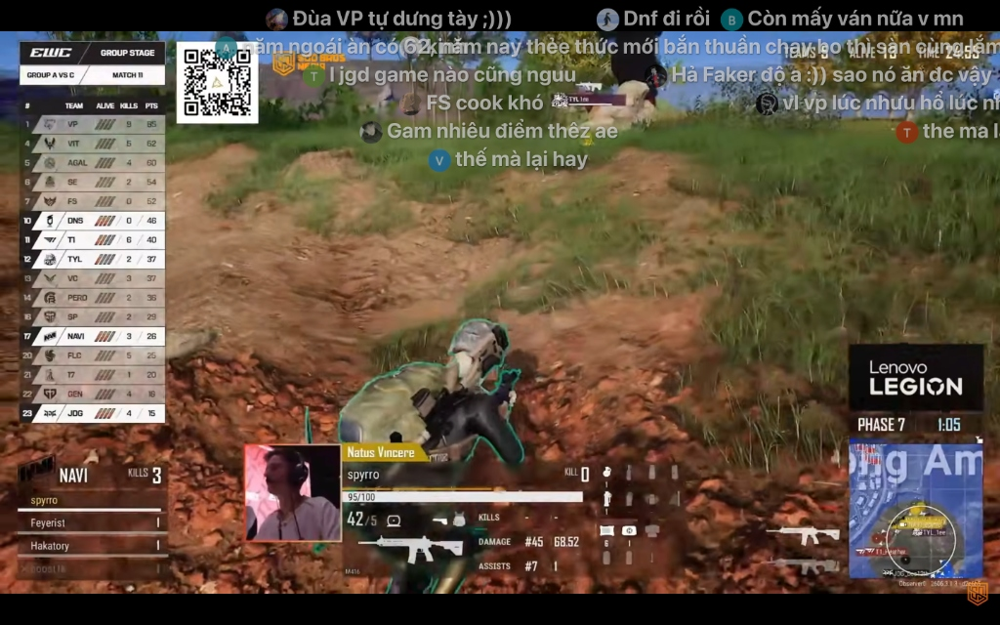
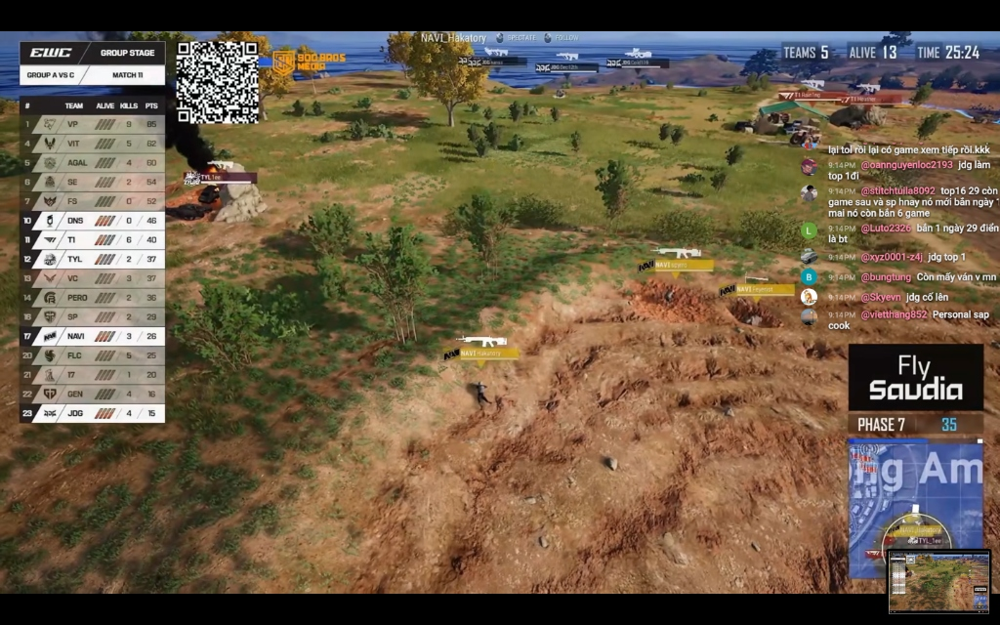

# DanmaChat – Fullscreen Live Chat Overlay & Danmaku for YouTube™

[Chrome Web Store](https://chromewebstore.google.com/detail/eapcgaoflonkgkhaeidekcnkaoniajad) · [Website](https://khanhnkq.github.io/youtube-chat-enhance/) · Formerly *YouTube Custom Chat & Danmaku*

[](https://developer.chrome.com/docs/extensions/mv3/intro/)
[](LICENSE)
[](#-supercharged-performance-60fps)

> **DanmaChat** is a high-performance **Manifest V3 browser extension for Chrome-based browsers and Firefox** designed to revolutionize your YouTube live stream and video watching experience. Features include **60FPS Hardware-Accelerated Danmaku Bullet Comments**, **Transparent Floating Chat Overlays**, **Real-time Live Color & Opacity Styling**, and **Auto-Hide Native Chat in Fullscreen Mode**.

---

## 📸 Screenshots & Live Demos

| 🎆 Danmaku Bullet Comments Mode (60FPS) | 💬 Transparent Floating Overlay Mode |
| :---: | :---: |
|  |  |

---

## ✨ Key Features

### 1. 🎆 60FPS Hardware-Accelerated Danmaku (Bullet Screen Comments)
- **On-Screen Flying Comments**: Streams live chat messages horizontally across your video from right to left in real-time (Bilibili / Niconico style).
- **DOM/WAAPI Danmaku Renderer**: Comments travel with compositor-only transforms, avoiding per-frame canvas redraws while maintaining smooth motion.
- **Smart Track Allocation**: Intelligent line-collision algorithms keep comments from overlapping; comments received while paused wait until playback resumes.
- **Customizable Appearance**: Customize text speed (4s - 20s), font size (14px - 38px), opacity, text color, outline stroke, and display area (Top 1/3, Top 50%, Top 75%, or Fullscreen).

### 2. 💬 Transparent Floating Chat Overlay
- **Direct Video Overlay**: Floating transparent live chat rendered over your video in both Fullscreen and Theatre mode.
- **Frameless & Borderless**: Eliminates dark headers, black bars, and unnecessary borders for a 100% clean video view.
- **Optional Chat Input**: “Hide Input Box & Footer” hides those controls in the floating overlay, including on hover. Turn it off to show YouTube's input or sign-in prompt immediately; the native chat is unchanged. Drag and resize controls still appear on hover.

### 3. 🎛️ Real-time Customization Control Panel
- **Draggable & Resizable**: Drag the title bar to position the chat box anywhere over your video. Resize from the bottom-right handle.
- **Minimized Floating Badge (`Live Chat`)**: Collapse the chat into a small, elegant badge at the corner of your video with one click.
- **Auto-Hide Native Chat in Fullscreen**: Automatically hides YouTube's native side chat in Fullscreen mode to expand the video player to 100% full screen width, restoring the original layout when exiting.
- **Live Color & Styling Pickers**: Adjust username colors, chat message colors, and background opacity. Continuous input is coalesced at 120ms intervals; ending an interaction commits the final value immediately.
- **Inline Color Editing**: Expand a color swatch to adjust RGB sliders or enter a hex color without leaving the popup; no operating-system chooser that can dismiss Firefox's popup and lose the selection.
- **No Video Blur**: The ineffective background-blur slider has been removed; the extension does not add blur over the video.
- **Saved Preferences**: New profiles start with Floating Chat on and Danmaku off. Profiles with existing settings keep their saved values and legacy Danmaku default, including when only some settings were saved. An empty storage profile is treated as new.

### ⚡ 4. Zero-Lag Performance Architecture
- **Single-Channel State Sync**: Uses `chrome.storage.onChanged` to apply changed settings across frames without duplicate runtime broadcasts or page reloads. Resetting placement is a separate, repeatable command rather than a persistent setting.
- **Batch IPC Messaging**: Batches high-volume incoming chat messages into 80ms buffers to reduce cross-frame IPC postMessage overhead by over 90%.

---

## 📦 Installation & Packaging Guide

### 1. Load for Development (Unpacked)
- **Google Chrome / Brave / Edge / Arc:**
  1. Open `chrome://extensions/`
  2. Enable **Developer mode** (top-right toggle).
  3. Click **Load unpacked** and select the project folder (or `dist/chrome`).
- **Mozilla Firefox:**
  1. Open `about:debugging#/runtime/this-firefox`
  2. Click **Load Temporary Add-on...**
  3. Select `manifest.json` from the project folder (or `dist/firefox/manifest.json`).

### 2. Multi-Browser Production Packaging
Build clean, lightweight packages (about 37 KB each) for both Chrome Web Store and Mozilla Add-ons (AMO):
```bash
npm ci
npm run build
```
The version comes from `manifest.json`. Output is written to `dist/`:
- `dist/chrome/` and `dist/firefox/`: unpacked builds for local testing.
- `dist/DanmaChat-Chrome-v<version>.zip` (for Chrome Web Store)
- `dist/DanmaChat-Firefox-v<version>.zip` (for Mozilla Add-ons / AMO)
- `dist/DanmaChat-Firefox-v<version>.xpi` (the same Firefox package with the `.xpi` extension)

The packages contain only `manifest.json`, `content/`, `popup/`, the icons the extension uses and `LICENSE`; documentation, screenshots, tests and build scripts are left out.

### 3. Release Packages
Built packages are release artifacts, not source: `dist/` and `*.zip`, `*.xpi`, `*.crx` are ignored by git, and `npm test` fails if one is committed. Get a package from one of these places instead:
- **Build it** with `npm run build` (above).
- **Pull request / `main` builds**: the `Checks` workflow uploads the three files as the `extension-packages` artifact (kept 14 days).
- **Releases**: attach the built files to the GitHub release for the tag, for example `gh release upload v<version> dist/*.zip dist/*.xpi`. Store uploads (Chrome Web Store, AMO) use the same files; see `CHROMEWEBSTORE.md` and `FIREFOXAMO.md`.

### Checks
Every pull request runs the checks in `.github/workflows/checks.yml`. Run the same set locally after `npm ci`:
```bash
npm run check
```
- `npm test`: unit tests.
- `npm run lint`: ESLint; fails on unused variables and empty blocks. A `catch` in a content script reports through `YTChatRuntime.diagnostics.report` (`content/runtime.js`), which logs an unexpected error a few times per source and then only counts it.
- `npm run build`: builds both packages.
- `npm run lint:firefox`: `web-ext lint` on `dist/firefox`; fails on errors and on warnings that are not listed in `scripts/firefox-lint-known-warnings.json`.

### Performance profiling
Start Chrome with `--remote-debugging-port=9222`.
Open a live stream and run `npm run perf -- 15 ext_on`.
Compare the results with the extension disabled.

---

## 📂 Project Structure

```
youtube-chat-enhance/
├── manifest.json               # Manifest V3 configuration (Firefox settings included)
├── _locales/                   # Localized store name and summary (en, vi, ja, zh_CN, zh_TW, ko)
├── content/
│   ├── config.js               # Shared defaults, profile migration & storage subscription
│   ├── chat-injector.js        # Watch/live page script: wires the chat overlay and Danmaku to the player
│   ├── chat-iframe.js          # Live chat iframe: message reader, 80ms batcher, overlay styling
│   ├── draggable-box.js        # Floating chat box: drag, resize, minimize, saved position
│   ├── danmaku-engine.js       # DOM/WAAPI Danmaku renderer and track allocation
│   └── overlay.css             # Overlay, Danmaku and fullscreen layout rules
├── popup/
│   ├── popup.html              # Settings panel markup
│   ├── popup.css               # Settings panel styles
│   ├── popup.js                # Settings UI, English/Vietnamese text, reset command
│   └── config-writer.js        # Coalesced, serialized storage writes
├── icons/                      # Extension icons (SVG + 16/48/128px PNG) and their generator
├── assets/                     # README screenshots (not packaged)
├── scripts/
│   ├── build.js                # Builds dist/chrome, dist/firefox and the ZIP/XPI packages
│   ├── lint-firefox.js         # web-ext lint on dist/firefox with a known-warnings list
│   └── perf/profile.mjs        # CPU/frame profiler over the Chrome DevTools Protocol
├── tests/                      # Unit tests (node --test)
├── .github/workflows/checks.yml  # Tests, lint, build and package upload on every PR
├── CHROMEWEBSTORE.md           # Chrome Web Store listing text
├── FIREFOXAMO.md               # Firefox Add-ons (AMO) listing text and submission steps
└── docs/archive/               # Completed plans, kept for history
```

---

## 📝 License & Author

- **Author:** [khanhnkq](https://github.com/khanhnkq)
- **License:** MIT License. Pull Requests and Contributions are always welcome!
